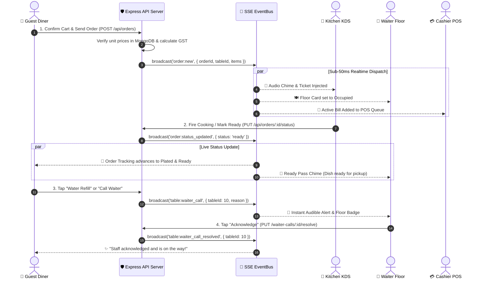

<div align="center">

# 🌿 AURA GASTRONOMY™
### Commercial Digital Dining, Real-Time KDS & Multi-Station POS Operating System

<p align="center">
  <b>An enterprise hospitality suite engineered for luxury fine dining, boutique bistros, and high-volume restaurants.</b><br />
  Featuring sub-50ms Server-Sent Events (SSE), zero-client-trust financial security, tactile mobile ergonomics, and automated dual-QR table stand generation.
</p>

[](.github/workflows/ci-cd.yml)
[](#-zero-client-trust-security-architecture)
[](#-real-time-sse-event-mesh--50ms)
[](#-technical-specifications)
[](#-technical-specifications)
[](#-mobile-ergonomics--pwa-installation)
[](LICENSE)

<br />

[⚡ Quickstart](#-quickstart--development-guide) &nbsp;•&nbsp;
[🏢 Station Directory](#-live-station-directory--default-credentials) &nbsp;•&nbsp;
[📡 Real-Time SSE Mesh](#-real-time-sse-event-mesh--50ms) &nbsp;•&nbsp;
[🛡️ Security Architecture](#-zero-client-trust-security-architecture) &nbsp;•&nbsp;
[🔌 API Reference](#-rest-api--event-stream-reference) &nbsp;•&nbsp;
[📲 PWA Setup](#-mobile-ergonomics--pwa-installation)

<br />

---

> **“Technology in a luxury restaurant should be like a world-class maître d' — always attentive when needed, completely seamless and invisible when dining.”**

<br />

<p align="center">
  <b>Architected & Handcrafted by <a href="https://github.com/Niranjan-Kumar-Singh">Niranjan Kumar Singh</a></b><br />
  <a href="mailto:niranjansingh1419@gmail.com"><code>niranjansingh1419@gmail.com</code></a> &nbsp;•&nbsp;
  <a href="https://instagram.com/niranjan.ks.in"><code>@niranjan.ks.in</code></a> &nbsp;•&nbsp;
  <a href="https://github.com/Niranjan-Kumar-Singh/AURA-GASTRONOMY-RESTAURANT">GitHub Repository</a>
</p>

</div>

---

## 🌟 Highlights & Capabilities at a Glance

| 📱 Guest Diner Portal (PWA) | 🍳 Kitchen Pass (KDS) | 🤵 Floor Command & Waiter | 💳 Cashier Billing POS |
|:---|:---|:---|:---|
| • **Instant QR Table Seating**<br>• **Zero Login Wall Barrier**<br>• **AI Pairing & Upsell Engine**<br>• **Tactile Mobile Haptics**<br>• **One-Tap Table Service** | • **Dark High-Contrast Pass**<br>• **Live Prep Milestones**<br>• **Line-Item Dish 86 Mode**<br>• **Dual-Tone Audio Chimes**<br>• **Active Elapsed Timers** | • **30-Table Visual Floor Map**<br>• **Sub-50ms Floor Chimes**<br>• **4 Live Dining Zones**<br>• **Auto Turnover Timers**<br>• **1-Tap Quick Reset** | • **Line-Item Partial Returns**<br>• **Audit-Grade Net Ledger**<br>• **80mm Thermal Slip Print**<br>• **Formal A4 GST Invoice**<br>• **Split Bill Calculations** |

<br />

> [!NOTE]
> **Key Architecture Guarantees:**
> * **⚡ Sub-50ms Push Latency:** Persistent **Server-Sent Events (SSE)** broadcast dining state changes instantly between Diners, Chefs, Waiters, and Cashiers without polling latency.
> * **🛡️ Zero-Client-Trust Financial Integrity:** Client price and discount payloads are discarded. The server computes item totals, verifies coupons, applies loyalty caps, and levies 5% GST authoritatively.
> * **📱 Native Mobile Ergonomics:** Features safe-area inset protection for bezel-less screens (`env(safe-area-inset-bottom)`), Web Audio synthesizers, and installable PWA offline caching.

---

## 📡 Real-Time SSE Event Mesh (< 50ms)

AURA eliminates traditional polling loops by leveraging a high-throughput **Server-Sent Events (SSE)** event bus. When any action occurs on the floor, updates reach all connected terminals in under 50 milliseconds:



### Supported SSE Event Payloads

| Event Name | Dispatched When | Primary Recipients | Action Triggered |
|:---|:---|:---|:---|
| `order:new` | Diner submits table cart | Kitchen KDS, Waiter, Cashier | Sound alert, ticket render, table set to `occupied` |
| `order:status_updated` | Kitchen advances prep stage | Diner Tracker, Waiter, Cashier | Stage animation advances, pass pickup chime |
| `order:item_updated` | Individual dish checked done | Kitchen KDS, Diner Tracker | Line item checkbox synchronizes |
| `order:item_cancelled` | Dish 86'd or ingredient depleted | Kitchen KDS, Diner, Waiter | Item strikethrough, total recalculated |
| `order:cancelled` | Entire ticket cancelled | All Terminals | Order marked void, loyalty points restored |
| `table:waiter_call` | Diner taps service button | Waiter Dashboard | Dual-tone audio chime & blinking table badge |
| `table:waiter_call_resolved` | Waiter acknowledges call | Diner Modal, Waiter Floor | Button resets to idle, confirmation toast |
| `table:status_updated` | Table state modified | Waiter Floor, Cashier POS | Visual zone map color change |
| `table:paid` | Cashier settles bill | All Terminals | Table set to `cleaning`, turnover countdown starts |

---

## ⚡ Station Modules & Core Capabilities

### 1. 📱 Contactless Diner Portal (`/menu`)
* **Zero Registration Wall:** Diners browse without passwords or mandatory app downloads. A 10-digit mobile number links order tracking, loyalty coins, and digital bills.
* **Dual Seating Verification:** Supports physical cryptographic table QR code scans (`/dine/:token`) and direct web table selection (Tables 1–30 + Mayfair Suite).
* **Tactile Mobile Ergonomics:** Native web haptic vibration (`navigator.vibrate`) on touch interactions, quantity steppers, and order confirmations.
* **Ambient Floating Service:** Instant one-tap requests for *Water Refill*, *Call Waiter*, *Extra Cutlery*, and *Request Bill*.
* **Smart Dietary Engine:** Combinable filtering for Vegetarian, Non-Vegetarian, Jain, Gluten-Free, Chef's Specials, and Bestsellers.
* **AI Upsell & Pairing Engine:** Suggests real, menu-verified beverage and side dish pairings with gamified spend-more tiers (unlock freebies at ₹500, ₹1000, ₹2000).

### 2. 🍳 Kitchen Display Terminal — KDS (`/kitchen`)
* **High-Contrast Culinary Pass:** Dark industrial theme engineered for visibility in steam, flame, and low kitchen lighting.
* **Prep Lifecycle Milestones:** Clear transition flow: `Received` ➔ `Preparing` ➔ `Ready` ➔ `Served`.
* **Line-Item Dish 86:** Instantly mark ingredients depleted. Automatically cancels individual line items without disrupting the rest of the table's active dining order.
* **Synthesized Audio Chimes:** Web Audio API sine harmonics (587Hz & 880Hz) sound automatically when new dining tickets land at the pass.

### 3. 🤵 Waiter Floor Command (`/waiter`)
* **30-Table Real-Time Floor Map:** Color-coded status overview across all four dining zones (*Main Hall*, *VIP Lounge*, *Outdoor Terrace*, *Family Section*):
  * 🟢 **Available** (Clean & ready for seating)
  * 🔵 **Occupied** (Actively dining with open orders)
  * 🟣 **Billing** (Check requested / awaiting cashier)
  * 🔘 **Cleaning** (Automatic countdown timer for floor turnover)
* **Active Service Dispatch Queue:** Dedicated tabs for **Ready Pass** (dishes plated and ready to run), **Waiter Calls**, and **Bill Requests**.
* **1-Tap Quick Actions:** Reset table, view active order ticket, or change table guest count directly from the floor view.

### 4. 💳 Cashier Billing POS Hub (`/cashier`)
* **Precision Audit Ledger:** Full support for **Full Refunds**, **Partial Offsets**, and **Item-Level Line Returns** with recorded audit justifications.
* **True Net Revenue Tracking:** Calculates `netAmount = total - refundAmount`, guaranteeing accounting ledgers reconcile to the penny.
* **Dual Printing Engine:**
  * **80mm Thermal Receipt:** Optimized for standard POS receipt printers with customer loyalty balances, coupon deductions, and cashier stamp.
  * **Formal A4 GST Invoice:** Commercial tax invoice with GSTIN, CGST/SGST tax slabs, customer information, and printable corporate layout.

### 5. 👑 Executive Suite & Analytics (`/admin`)
* **Real Database Aggregations:** Live metrics for today's net sales, ongoing orders, completed covers, and average order value (AOV).
* **24-Hour Hourly Rush Heatmap:** Visual analysis of peak floor hours to optimize kitchen staff scheduling.
* **Dish Velocity & Margins:** Top revenue-generating dishes with dynamic gross margin percentages.
* **Menu Catalog & Category Editor:** Live dish availability toggling, pricing management, and category display ordering.
* **Coupon Campaign Engine:** Create, activate, and manage promo codes with minimum order thresholds and one-time discount protections.

### 6. 🖨️ Dual-QR Acrylic Table Stand Studio (`/admin/qr-generator`)
* **Print-Ready Table Stands:** Bespoke visual stand generator formatted for acrylic table tents (A4, A5, A6).
* **Dual-QR Integration:** Combines **WPA Guest Wi-Fi Auto-Connect QR** (one tap to connect) alongside **Cryptographic Table Order QR** on a single luxury branded card.
* **Direct Export:** Instant 300 DPI high-resolution PNG export and browser print styling (`@media print`).

---

## 🛡️ Zero-Client-Trust Security Architecture

1. **Authoritative Server Pricing:** Client price and discount inputs are completely stripped. The server computes item totals, verifies coupon eligibility in MongoDB, applies loyalty points caps, and calculates 5% GST authoritatively.
2. **Deep NoSQL Sanitizer:** Recursive request middleware inspects `req.body`, `req.query`, and `req.params`, neutralizing injection operators (`$gt`, `$regex`, `$where`, `__proto__`, `constructor`).
3. **Compound Database Indexing:** Optimized compound indexes on `(tableId, status)`, `(status, paymentStatus)`, `(paymentStatus, paidAt)`, and `createdAt` guarantee sub-millisecond query performance under floor load.
4. **Origin-Allowlist CORS:** Strictly protects API endpoints against unauthorized origins while supporting local LAN testing (`192.168.x.x`) and Vercel cloud domains.
5. **Session & Role Authentication:** JWT authentication with cryptographically enforced secrets (`JWT_SECRET`) and role-based access control (`ADMIN`, `MANAGER`, `OWNER`, `CHEF`, `WAITER`, `CASHIER`).
6. **Graceful Process Lifecycle:** Registered `SIGTERM` and `SIGINT` lifecycle hooks close HTTP listeners and MongoDB connection pools cleanly.

---

## 🛠️ Technical Specifications

| Component | Technology | Rationale |
|:---|:---|:---|
| **Frontend Framework** | React 18, TypeScript 5.3 (Strict) | Deterministic type safety across menus, cart models, and tickets. |
| **Build & Tooling** | Vite 5, Tailwind CSS 3.4 | Ultra-fast HMR, optimized production tree-shaking, and CSS utility tokens. |
| **State Management** | Zustand 4.5 (with LocalStorage Sync) | Lightweight, zero-boilerplate client state for multi-device cart sync. |
| **Data Querying** | TanStack Query v5 (`@tanstack/react-query`) | Top-level `QueryClientProvider` for automated caching & request deduplication. |
| **Animation & Motion** | Framer Motion 11 | Hardware-accelerated UI transitions, drawers, and modal backdrops. |
| **Sound Engine** | Web Audio API (Synthesized Chimes) | Dual-tone sine harmonics (587Hz & 880Hz) with 0 network payload. |
| **Mobile Integration** | W3C Web App Manifest (PWA) | Standalone fullscreen kiosk installation on Android, iPad, and desktop. |
| **Backend Runtime** | Node.js 22 LTS, Express 5.2.1 | Modern async error handling and non-blocking I/O. |
| **Realtime Mesh** | Server-Sent Events (SSE) | Sub-50ms push updates via persistent HTTP stream (`/api/events/stream`). |
| **Database** | MongoDB Atlas, Mongoose 9.9 | Scalable document storage with embedded refund histories and compound indexes. |
| **Cloud Deployment** | Dual Mode: Standalone Node / Vercel Serverless | Dedicated Express server on Port 5000 + Serverless Function (`api/index.js`). |

---

## 🏢 Live Station Directory & Default Credentials

| Station | Route | Default Access | Description |
|:---|:---|:---|:---|
| 📱 **Guest Digital Menu** | `/menu` | *Open to all diners* | Dynamic menu, dietary filters, table cart, checkout |
| ⏱️ **Order Tracking Pass** | `/order/:orderId` | *Automatic on checkout* | Live stage tracker (`Received` ➔ `Preparing` ➔ `Ready` ➔ `Served`) |
| 🍳 **Kitchen Pass (KDS)** | `/kitchen` | `chef@aura.com` / `chef123` | High-contrast cooking pass with line-item cancellation |
| 🤵 **Floor Command** | `/waiter` | `waiter@aura.com` / `waiter123` | 30-table layout, audio chimes, service dispatch |
| 💳 **Cashier POS** | `/cashier` | `cashier@aura.com` / `cashier123` | Bill settlement, line-item refunds, thermal & GST print |
| 👑 **Executive Dashboard** | `/admin` | `admin@aura.com` / `admin123` | Net sales, hourly heatmap, dish margins, menu management |
| ⚙️ **Venue Settings** | `/admin/settings` | `admin@aura.com` / `admin123` | Restaurant name, host domain, guest Wi-Fi credentials |
| 🖨️ **QR Table Studio** | `/admin/qr-generator`| `admin@aura.com` / `admin123` | Acrylic dual-QR table stand generator & 300 DPI export |
| 🔐 **Staff Login** | `/login` | Master Passcode: `AURA2026` | 1-click station switcher for dedicated floor tablets |

---

## 💻 Quickstart & Development Guide

### Prerequisites
* **Node.js**: v20 or v22 LTS ([Download Node.js](https://nodejs.org/))
* **MongoDB**: Local MongoDB instance or free [MongoDB Atlas](https://www.mongodb.com/atlas) cluster URI

---

### Step 1: Clone & Configure Environment

```bash
# Clone repository
git clone https://github.com/Niranjan-Kumar-Singh/AURA-GASTRONOMY-RESTAURANT.git
cd AURA-GASTRONOMY-RESTAURANT

# Copy environment template
cp .env.example .env
```

Ensure your `.env` contains your MongoDB connection URI and a secure JWT secret:
```env
PORT=5000
NODE_ENV=development
MONGO_URI=mongodb+srv://<username>:<password>@cluster.mongodb.net/aura_restaurant?retryWrites=true&w=majority
JWT_SECRET=aura_enterprise_super_secure_jwt_secret_key_minimum_64_characters_long_2026
ALLOWED_ORIGINS=http://localhost:5173,http://localhost:3000,http://127.0.0.1:5173
```

---

### Step 2: Install Dependencies & Seed Catalog

```bash
# Install root, frontend & backend dependencies
npm install
npm --prefix frontend install
npm --prefix backend install

# Seed database with full menu catalog, staff roles, and tables
npm run seed
```

---

### Step 3: Run Full-Stack Development Server

Launch both the **Express Backend (Port 5000)** and **Vite Frontend (Port 5173)** with single-command live reload:

```bash
npm run dev
```

* 📱 **Frontend Client:** [http://localhost:5173](http://localhost:5173)
* 🛡️ **Backend API:** [http://localhost:5000/api](http://localhost:5000/api)
* 📡 **Real-Time SSE Stream:** [http://localhost:5000/api/events/stream](http://localhost:5000/api/events/stream)
* 🩺 **Health Check:** [http://localhost:5000/api/health](http://localhost:5000/api/health)

---

### Step 4: Verification & Automated Test Suite

Run the full end-to-end verification pipeline (backend syntax checks + frontend TypeScript compile + Vite production bundling):

```bash
npm test
```

Expected output:
```bash
> node --check server.js
> tsc -b && vite build
✓ built in 5.67s (0 errors)
```

---

## 🔌 REST API & Event Stream Reference

### Real-Time Event Stream (`/api/events`)
* `GET /api/events/stream`: Persistent Server-Sent Events stream for instant floor updates.
* `GET /api/events/status`: Active SSE subscriber count & health check.

### Order Operations (`/api/orders`)
* `POST /api/orders`: Submit new dining order (authoritatively verifies prices and discounts).
* `GET /api/orders/:orderId`: Retrieve specific order tracking data.
* `GET /api/orders/active`: Kitchen KDS active order feed.
* `PUT /api/orders/:orderId/status`: Advance prep milestone (`received` ➔ `preparing` ➔ `ready` ➔ `served`).
* `PUT /api/orders/:orderId/items/check`: Toggle individual dish preparation status.
* `PUT /api/orders/:orderId/items/:itemIndex/cancel`: Line-item 86 dish cancellation.
* `PUT /api/orders/:orderId/cancel`: Cancel entire ticket and restore loyalty points.
* `POST /api/orders/pay-table`: Cashier bill settlement and automatic table turnover.
* `POST /api/orders/:orderId/refund`: Execute full or partial refund with audit logging.

### Table & Floor Management (`/api/tables`)
* `GET /api/tables`: Retrieve all 30 dining tables with live order metadata.
* `GET /api/tables/table-number/:tableNumber`: Retrieve specific table by number.
* `PUT /api/tables/:tableId/status`: Update table floor state (`available`, `occupied`, `billing`, `cleaning`).
* `POST /api/tables/call-waiter`: Dispatch instant diner service request.
* `GET /api/tables/waiter-calls`: Retrieve active waiter assistance requests.
* `PUT /api/tables/waiter-calls/:id/resolve`: Acknowledge and resolve waiter call.
* `POST /api/tables/:tableId/rotate-qr`: Rotate cryptographic QR secret for physical security.

### Menu Catalog (`/api`)
* `GET /api/menu/categories`: Retrieve all menu categories with icons.
* `GET /api/menu/items`: Search and filter dishes by category, dietary tags, and keywords.

---

## 📲 Mobile Ergonomics & PWA Installation

AURA Gastronomy is designed from the ground up as a Progressive Web App (PWA):
1. **Diners**: Scan any physical table QR stand to open the mobile menu directly in Safari, Chrome, or Samsung Internet without app installs. Supports iPhone notch and Android gesture safe areas (`viewport-fit=cover`, `env(safe-area-inset-bottom)`).
2. **Floor Staff & Kitchen Monitors**: Open `/waiter` or `/kitchen` on an iPad, Galaxy Tab, or Android tablet, tap **Share / Settings ➔ Add to Home Screen**, and launch AURA as a **standalone, borderless kiosk app**.

---

## 📄 License & Credits

This platform is architected and maintained by **[Niranjan Kumar Singh](https://github.com/Niranjan-Kumar-Singh)** and licensed under the **[MIT License](LICENSE)**. Open for adaptation, commercial deployment, and extension across hospitality venues worldwide.
